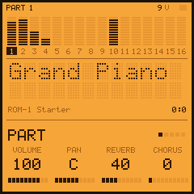

# ROM-1 for the M-VAVE FM-1

[](https://github.com/devrvega/ROM-1/actions/workflows/build.yml)
[](https://github.com/devrvega/ROM-1/releases/latest)
[](LICENSE)

ROM-1 turns the M-VAVE FM-1 into a sixteen-part sound module, as the rack modules of the nineties were: a part
for each MIDI channel, each playing a preset of the sounds you put on it, with a filter, envelopes, reverb and
chorus. It plays .sf2 files: choose them in the browser, and they are converted there to fit the FM-1 with the
best quality that fits, then put on it over USB. The keys play the part on the screen; MIDI over USB or the TRS
jack plays all sixteen at once. It comes with starter sounds of its own: a General MIDI handful and a drum kit.



| | |
|---|---|
| **[Try it in the browser](https://devrvega.github.io/ROM-1/emu/)** | The same code the FM-1 runs: the starter sounds, or your .sf2 files. No FM-1 needed. |
| **[Your sounds](https://devrvega.github.io/ROM-1/sounds/)** | Choose .sf2 files and presets; they are converted in the browser and put on the FM-1 with ROM-1. |
| **[Install it](https://devrvega.github.io/ROM-1/install/)** | ROM-1 with its starter sounds, from Chrome or Edge, the FM-1 on USB. |
| **[Read the manual](docs/MANUAL.md)** | Getting started, then every knob, page and MIDI message, and what fits. |
| **[Download](https://github.com/devrvega/ROM-1/releases/latest)** | The firmware file (`rom1-X.Y.Z.fwsc`) of every release, and its source. |

## What fits

ROM-1 keeps about 740 KB of sounds: about 468 KB inside the firmware and 276 KB in the FM-1's data area. The
converter keeps each sample 16-bit where there is room; when there is not, it steps the biggest down first: to
4-bit ADPCM, then to lower sample rates (32, 22, 16, 11, 8 kHz), as much as needed and no more. The fonts go in
in the order you give them, so that whole fonts sit in the firmware first.

- **Game-console and chiptune fonts** (SNES, GBA, Genesis, NES, Game Boy rips) are small and usually fit whole,
  several at once: four SNES soundtracks' fonts (151 presets) fit together at a mix of 16-bit and 4-bit.
- **General MIDI sets** of a few megabytes fit whole at reduced quality, or pick the presets you need.
- **Big fonts** (tens or hundreds of megabytes, long multisampled pianos, rendered pads): pick a few presets.
  The page shows how full it is and at what quality, as you tick them.

Each font gets a bank number in the order you give them: bank select (CC 0) picks the font, program change its
preset, and channel 10 plays the font's drum kit.

## In short

| | |
|---|---|
| Keys · OCT− OCT+ | Play the part on the screen (F3 to G5) · the octave |
| ALGORITHM · PRESETS · SELECT | The part (1–16, MIDI channels 1–16) · its preset (GLO held: the next font) · the page |
| Knobs 1–4 | The page's values: PART volume, pan, reverb, chorus · SOUND cutoff, resonance, attack, release · EFFECTS reverb kind, time, level, chorus · SETUP velocity, transpose, keys out, lights |
| HOME · ENV / LFO · FX · SEQ | The PART, SOUND, EFFECTS and BANK pages (GLO held long: SETUP) |
| PLAY · ARP · REC | A phrase on the part · hold (the sustain pedal) · all notes off |
| SEL · EDIT · SAVE | Mute (GLO: solo) · the part's knobs back (GLO: a GM reset) · save the settings now |

Hold any button for a second and a card says what it does.

## Installing, and going back

- **With your sounds:** the [Your sounds](https://devrvega.github.io/ROM-1/sounds/) page (Chrome or Edge, a
  USB data cable) installs ROM-1 with them in one go. From the command line: `pip3 install mido python-rtmidi`,
  then `python3 tools/rom1_load.py --package rom1-X.Y.Z.fwsc FONT.sf2 ...`.
- **With the starter sounds:** the [web installer](https://devrvega.github.io/ROM-1/install/), or
  `python3 tools/fm1_install.py rom1-X.Y.Z.fwsc` with the file from the
  [latest release](https://github.com/devrvega/ROM-1/releases/latest).
- **Going back:** the installer's "Back to the stock firmware" puts M-VAVE's firmware back, as does M-VAVE's
  own updater, M-UPGRADE. Any other FM-1 firmware installs over ROM-1 as it would over the stock one.
- **Other firmwares' saved work:** the sounds that do not fit in the firmware go to the FM-1's data area, where
  some firmwares keep their samples, patterns or songs; putting your sounds on replaces what another firmware
  kept there. ROM-1's settings live in the FM-1's settings memory.

Installing other firmware is at your own risk, though it's hard to get stuck: an FM-1 that fails to start
twice comes up in a safe mode the installer can reach, and the manual's
[Troubleshooting](docs/MANUAL.md#11-troubleshooting) covers the rest.

## MIDI

Sixteen parts, one for each channel, over USB and the TRS MIDI input alike. Notes and velocity; pitch bend and
its range (RPN 0), fine and coarse tuning (RPN 1, 2); modulation (CC 1) and channel pressure for vibrato; volume
(7), pan (10), expression (11), sustain (64), resonance (71), release (72), attack (73), cutoff (74), reverb
(91) and chorus (93) sends; bank select (0, 32) and program change; all sound off (120), reset controllers
(121), all notes off (123); General MIDI's and GS's resets. With KEYS OUT on, the keys go out over USB too.

## Status

ROM-1 is young (0.x). It has been measured on an FM-1: the engine renders 128 frames at a time (2.9 ms at
44.1 kHz), about 63 µs a voice. Sixteen parts each starting a note every 30 ms, stealing voices all the while,
take 70 % of the FM-1's time on average and at most 2.5 ms of a render's 2.9; none is late. A voice cap starts
at 28 voices and follows the render time: up to 32 while there is room, down at once when a render runs long.
The data area's part of a bank goes over USB at about 34 KB a second (280 KB in 8.3 s), checked as it lands.
Feedback on how it sounds is what helps most now.

## Ideas and problems

- **Something you'd like:** a [feature request](https://github.com/devrvega/ROM-1/issues/new?template=feature_request.yml).
- **Something wrong:** a [bug report](https://github.com/devrvega/ROM-1/issues/new?template=bug_report.yml)
  (the version is on the BANK page, and on the screen when the FM-1 starts).

## Make it your own

Fork it, change it, release your own: [CONTRIBUTING.md](CONTRIBUTING.md) says where things are, how to give
your version its own name and identity, and how to send changes back. Every push is built and tested on
GitHub; a tag `vX.Y.Z` makes a release, and the site (emulator, installer, your sounds, manual) follows it.

```
tests/run_tests.sh                                   # the tests: the converter, the engine, the app in a simulator
./build.sh                                           # build/rom1.fwsc, with the starter sounds (see BUILDING.md)
python3 tools/rom1_load.py FONT.sf2                  # your sounds: converted, installed, the rest sent over USB
```

## Credits

ROM-1 is built on SEQ-4, CRT-4, LCD-4 and IND-1, themselves built on
[AMB-1](https://github.com/charlesvestal/fm1-amb) by Charles Vestal: the frame, screen, simulator and emulator.
The platform (hardware layer, USB, update loader, storage, installer) is
[Felucca](https://github.com/hugelton/Felucca)'s by Leo Kuroshita (Hügelton Instruments), by way of
[X0X](https://github.com/charlesvestal/fm1-x0x), FoMni, AMB-1, IND-1, LCD-4, CRT-4 and SEQ-4. The engine, the
converter and the starter sounds are ROM-1's own. The idea of running FM-1 firmware in the browser comes from
[Groove OS](https://www.groove-os.com/). GPL-3.0-only; see [LICENSING.md](LICENSING.md).

The .sf2 files you put on ROM-1 are not part of it: their samples belong to whoever made them, and their
licenses say what you may do with them. M-VAVE and FM-1 are trademarks of their owners. ROM-1 is not affiliated
with M-VAVE, Charles Vestal or Hügelton Instruments.
