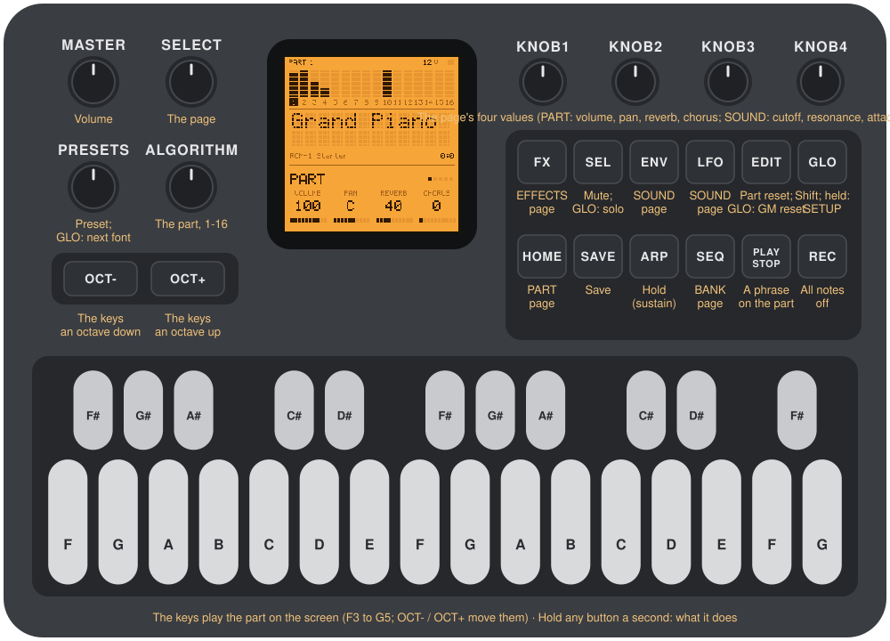
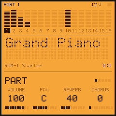
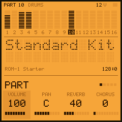
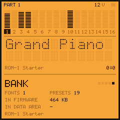
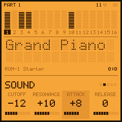
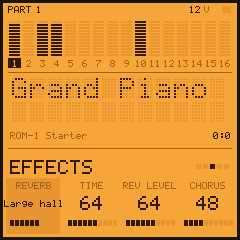
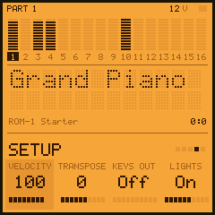
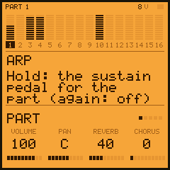

# ROM-1 manual

ROM-1 is firmware for the M-VAVE FM-1 that makes it a sixteen-part sound module playing .sf2 files. This manual
covers version 0.1.

1. [What it is](#1-what-it-is)
2. [Getting started](#2-getting-started)
3. [The panel](#3-the-panel)
4. [The screen](#4-the-screen)
5. [Parts, fonts and presets](#5-parts-fonts-and-presets)
6. [The pages](#6-the-pages)
7. [The buttons](#7-the-buttons)
8. [Your sounds](#8-your-sounds)
9. [MIDI](#9-midi)
10. [The engine](#10-the-engine)
11. [Troubleshooting](#11-troubleshooting)

## 1. What it is

ROM-1 plays sounds: sixteen parts, one for each MIDI channel, each with a preset of the fonts on the FM-1. MIDI
over USB or the FM-1's TRS jack plays them all at once, as a sound module in a rack would; the FM-1's own keys
play the part on the screen. Each part has its volume, pan, reverb and chorus sends, and a filter and envelope
to shape its preset.

The sounds are .sf2 files (the format most sample-based instruments are shared in). The FM-1 has no room for
them as they are, so they are converted to fit: on the "Your sounds" page, in the browser, or with
`tools/rom1_load.py`. ROM-1 comes with starter sounds of its own: eighteen General MIDI instruments and a drum
kit.

## 2. Getting started

1. Install ROM-1: the web installer for the starter sounds, or the "Your sounds" page for yours. The FM-1
   starts with the piano on part 1.
2. Play the keys. **OCT−** and **OCT+** move them an octave.
3. Turn **PRESETS**: the part's next preset. Its name fills the middle of the screen.
4. Turn **ALGORITHM**: the next part. Part 10 is the drum part: play the keys for its kit.
5. Turn **knob 1**: the part's volume. Knobs 2–4: pan, reverb, chorus.
6. Press **ENV**: the SOUND page. Knob 1 darkens or brightens the sound (cutoff), knob 3 slows its attack.
7. Press **FX**: the EFFECTS page, the reverb's kind, time and level, and the chorus.
8. Press **PLAY**: a phrase on the part, to hear it while you turn the knobs. PLAY again stops it.
9. Connect the FM-1 to a computer and play it from your music software: channel 1 plays part 1, channel 2
   part 2, and so on. Program change picks a part's preset.
10. Settings save themselves a few seconds after a change, when nothing sounds; **SAVE** saves at once.

Hold any button for a second and a card says what it does.

## 3. The panel



| Control | On its own | With GLO held |
|---|---|---|
| **Keys** | Play the part on the screen, F3 to G5 (velocity from the SETUP page) | |
| **OCT− / OCT+** | The keys down, up an octave (three each way) | |
| **ALGORITHM** | The part, 1–16 | |
| **PRESETS** | The part's preset, within its font (round) | The next font's first preset (on the drum part: its kit) |
| **SELECT** | The page: PART, SOUND, EFFECTS, SETUP, BANK | |
| **Knobs 1–4** | The page's four values | |
| **HOME** | The PART page | |
| **ENV, LFO** | The SOUND page | |
| **FX** | The EFFECTS page | |
| **SEQ** | The BANK page | |
| **GLO** | Shift | Held alone a moment: the SETUP page |
| **PLAY** | A phrase on the part (a beat on a kit); again: stop | |
| **ARP** | Hold: the sustain pedal for the part, on and off | |
| **SEL** | The part muted, or not | Solo: the others muted (again: all back) |
| **EDIT** | The part's knobs back to how they start | Everything back: a General MIDI reset |
| **REC** | All notes off, every part | |
| **SAVE** | The settings saved now | |

**MASTER** is the volume. OCT− and OCT+ together for five seconds: the FM-1's update mode (as with every FM-1
firmware).

## 4. The screen




The screen is a module's backlit LCD, in three bands.

- **The parts:** sixteen level meters, one a part, and their numbers under them; the part on screen is the
  dark one. At the top: the part's number (and DRUMS on part 10), the voices sounding, and a square lit while
  notes come.
- **The preset:** its name in big dots, on two lines if it needs them; under it, its font's name and its
  bank and program numbers (128 for a kit). A message comes here for a moment when something changes (a
  preset's name as you turn PRESETS, SAVED, ALL NOTES OFF).
- **The page:** its name, the five pages as dots, and its four knobs: what each does, its value, and where it
  is in its range. The one you turned last is lit for a moment. A button held a second shows its card here.

## 5. Parts, fonts and presets

A **part** plays one preset. Part *n* listens to MIDI channel *n*; part 10 is the drum part, which plays kits
(the presets a font keeps in bank 128).

A **font** is one .sf2 file, as it went onto the FM-1: its presets, in the bank and program numbers it gave
them. The fonts are numbered in the order you gave them, from 0 (the BANK page lists them).

- **On the panel:** PRESETS turns through the part's font; GLO + PRESETS moves to the next font. On the drum
  part they choose among kits.
- **Over MIDI:** bank select's first half (CC 0) picks the font, its second half (CC 32) the font's own bank,
  and program change the preset. A bank select alone changes nothing until the program change. If the font has
  no such preset, the part takes the font's nearest (the same program in bank 0, or its first). On channel 10,
  program change picks the font's kit.



## 6. The pages

| Page | Knob 1 | Knob 2 | Knob 3 | Knob 4 |
|---|---|---|---|---|
| **PART** | Volume | Pan | Reverb send | Chorus send |
| **SOUND** | Cutoff | Resonance | Attack | Release |
| **EFFECTS** | Reverb: room, hall, large hall, plate, off | Reverb time | Reverb level | Chorus level |
| **SETUP** | The keys' velocity | The part's transpose (±24) | KEYS OUT: the keys to MIDI too | The lights: off, on, keys |
| **BANK** | | | | |





- **PART and SOUND** are the part's, as its MIDI controllers are (CC 7, 10, 91, 93; 74, 71, 73, 72): turning
  the knob and sending the controller do the same. SOUND's values go from −64 to +63 around the preset's own:
  0 is the preset as it was made.
- **EFFECTS** is everyone's: one reverb and one chorus, which each part sends to.
- **SETUP** is the keys': how hard they play, whether they also go out over USB (to play something else from
  the FM-1), and the lights.
- **BANK** says what is loaded: the fonts, the presets, how much is in the firmware and how much in the data
  area (and MISSING if the data area's part is not there), the bank's name and ROM-1's version.

## 7. The buttons



- **PLAY** plays a phrase on the part on screen, an arpeggio (or a beat, on a kit), to hear a preset and what
  the knobs do. Again: it stops.
- **ARP** is the sustain pedal for the part: notes ring on after their keys let go, until ARP again.
- **SEL** mutes the part (its notes go on, unheard); **GLO + SEL** solos it.
- **EDIT** puts the part's knobs back; **GLO + EDIT** does what a General MIDI reset does: every part back to
  its first preset and knobs.
- **REC** stops every note at once.
- **SAVE** saves the settings now. They also save themselves a few seconds after a change, once nothing is
  sounding (writing to the flash pauses the sound for a moment). What is kept: each part's preset (by its
  font, bank and program) and knobs, mute and transpose; the effects; the keys' settings. With another bank on
  the FM-1, the parts start afresh.

## 8. Your sounds

### What fits

ROM-1 has about **740 KB** for sounds: about 468 KB inside the firmware and 276 KB in the FM-1's data area. A
font's presets, their zones and parameters take a little; nearly all of it goes on the samples.

The converter keeps every sample at its best: 16-bit at its own rate. When that does not fit, it steps the
biggest samples down first, one level at a time, until everything fits:

| Level | A sample | Its size against 16-bit |
|---|---|---|
| 16-bit | As it is in the file | 1 |
| 4-bit | 4-bit ADPCM at its own rate (up to 44.1 kHz) | about 0.28 |
| 4-bit, 32 kHz | ... at 32 kHz at most | |
| 4-bit, 22 kHz | ... at 22.05 kHz | |
| 4-bit, 16 kHz | ... at 16 kHz | |
| 4-bit, 11 kHz | ... at 11.025 kHz | |
| 4-bit, 8 kHz | ... at 8 kHz: the last step | |

Lowering a sample's rate keeps its pitch and loops exact; it loses the highest frequencies. 4-bit ADPCM adds a
little noise, mostly heard in quiet, pure sounds.

Roughly: game-console and chiptune fonts (SNES, GBA, Genesis, NES, Game Boy rips) are small and fit whole,
often several at once; General MIDI sets of a few megabytes fit at reduced quality; from big fonts (tens or
hundreds of megabytes) pick a few presets. Stereo presets take twice the room of mono ones.

### The "Your sounds" page

1. Open the page in Chrome or Edge and choose (or drop) one or more .sf2 files. They stay on your computer:
   the page reads them there, a piece at a time, and sends nothing to a server.
2. Each file is a font, numbered in the order you chose them (Up and Down move them); all its presets are
   ticked. Untick what you don't need: the bar shows how full the FM-1 is and the line under it at what
   quality, as you go. If it says too much, untick more.
3. Give the bank a name and press **Convert** (a second or so; big fonts longer).
4. **Try in the emulator** opens ROM-1 in the browser with these sounds, to hear them first.
5. **Put on the FM-1**, the FM-1 on USB: the page installs ROM-1 with the firmware's part of your sounds in it
   (about a minute), then writes the rest to the data area (about 34 KB a second) and checks it.

The firmware's part plays as soon as ROM-1 starts; the data area's part plays once it is written and checked.
If writing it stops halfway, the presets whose samples are there stay silent (the BANK page says MISSING)
until you press the button again. Fonts go in in order, so the first fonts are in the firmware as far as they
fit.

### From the command line

```
pip3 install mido python-rtmidi
python3 tools/rom1_load.py --package rom1-0.1.0.fwsc --name "My sounds" A.sf2 B.sf2@0:0,0:48,128:0
```

`FONT.sf2@BANK:PROG,...` takes only those presets (bank 128: kits). It converts, installs and writes the data
area as the page does; `--region-b` writes the data area again on its own. `build/gen/rom1conv -l FONT.sf2`
lists a font's presets and their sizes.

### Keeping your sounds

Your sounds are part of the firmware. Installing ROM-1 again, an update or the plain installer, brings the
starter sounds back: to keep yours, put them on again from the page (with the new version). The data area is
where some other firmwares keep their samples or songs: putting your sounds on replaces what was there.

## 9. MIDI

Sixteen parts on channels 1–16, over USB and the TRS MIDI input alike.

| Message | What it does |
|---|---|
| Note on, note off | Velocity shapes the volume, and picks among a preset's layers |
| Program change | The part's preset in the font picked by bank select |
| CC 0, CC 32 | Bank select: the font (from 0), the font's own bank |
| Pitch bend | ±2 semitones, or as RPN 0 sets |
| CC 1, channel pressure | Vibrato (as the preset's own) |
| CC 7, 11 | Volume, expression |
| CC 10 | Pan |
| CC 64 | Sustain pedal |
| CC 71, 74 | Resonance, cutoff (around the preset's own) |
| CC 72, 73 | Release, attack (around the preset's own) |
| CC 91, 93 | Reverb send, chorus send |
| CC 101, 100, then 6 | RPN 0 bend range, 1 fine tuning, 2 coarse tuning (data entry's coarse half) |
| CC 120, 123 | All sound off, all notes off |
| CC 121 | Reset controllers |
| General MIDI on, GS reset (SysEx) | Every part back to how it starts |

With KEYS OUT on (SETUP), the keys also go out over USB on the part's channel. The FM-1's TRS jack is an input
only.

## 10. The engine

- **Voices:** up to 32. A cap starts at 28 and follows how long the FM-1 takes to render each 2.9 ms of
  sound: down at once when a render runs long, up a voice at a time while there is room, back to 28 after a
  quiet moment. When a new note needs a voice and none is free, the quietest released one (else the oldest)
  gives way.
- **Playing a sample:** cubic interpolation; loops as the font sets them (continuous, or until the key lets
  go); exclusive classes (an open hi-hat cut by the closed one).
- **Each voice:** a resonant low-pass filter; the .sf2 volume and modulation envelopes (delay, attack, hold,
  decay, sustain, release, and the volume envelope's key tracking); the vibrato and modulation LFOs; the
  standard default modulators (velocity to volume, the mod wheel and pressure to vibrato, pitch bend). A font's
  own extra modulators are not used.
- **Effects:** a stereo reverb (four kinds) and a chorus, each part sending to them; a soft limiter on the
  output.
- **Rate:** 44.1 kHz, as the FM-1 plays.

## 11. Troubleshooting

- **No sound from a part:** its volume (PART page), mute (SEL), and that MIDI comes on its channel. Some
  presets are made to be played high or low: try other keys.
- **Some presets silent, BANK says MISSING:** the data area's part of your sounds is not there. Put them on
  again from the "Your sounds" page (or `tools/rom1_load.py --region-b`).
- **The sounds are the starter ones again:** ROM-1 was installed again (an update brings the starter back):
  put yours on again.
- **Clicks or notes cut short with many notes:** the voice cap keeps the FM-1 in time by stealing voices.
  Fewer parts at once, or presets with fewer layers, help.
- **Stuck notes:** REC (all notes off), or CC 123 / 120 from your software.
- **Your music software shows another name for the FM-1** (another firmware's, or M-VAVE's): computers
  remember a USB device's name from the first time they saw it. It is the same FM-1; removing it from the
  computer's MIDI settings (on a Mac, Audio MIDI Setup) and plugging it in again shows ROM-1's.
- **"Too much" on the page even with few presets:** some fonts' presets are huge (long stereo samples). Untick
  more, or pick presets from smaller fonts.
- **A preset sounds wrong:** the converter follows the .sf2 rules, but fonts differ; a bug report with the
  font's name and the preset helps.

### Recovering an FM-1 that won't start

After two failed starts the FM-1 comes up in a safe mode (USB only, no sound), and the web installer can
reach it: install ROM-1 again, or the stock firmware. OCT− and OCT+ held at power-on calibrates the panel; held
for five seconds, the update mode. If nothing answers at all, `bash tools/fm1_rescue.sh` on a Mac puts M-VAVE's
stock firmware back over USB.
